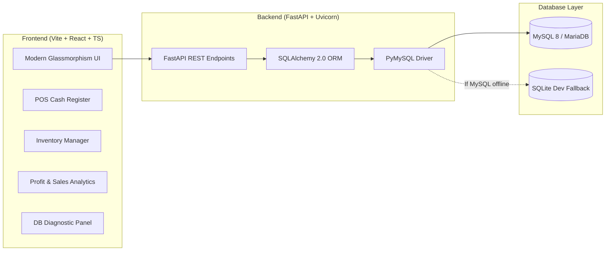

# TindaMate 🛒✨
### Smart Sari-Sari & Retail Store Companion
A high-performance full-stack management and POS system built with **React + Vite + TypeScript**, **Python FastAPI**, and **MySQL** (SQLAlchemy 2.0).

---

## 🚀 Architecture Overview



---

## 🛠️ Tech Stack

| Layer | Technology | Details |
|---|---|---|
| **Frontend** | React 18 + Vite | TypeScript, Lucide Icons, Glassmorphism Vanilla CSS |
| **Backend** | Python 3.12 + FastAPI | Pydantic v2, Uvicorn, CORS Middleware |
| **Database** | MySQL (with SQLite Fallback) | SQLAlchemy 2.0, PyMySQL driver, auto-table creation |
| **Environment** | `.env` based configuration | Local XAMPP/WampServer, Docker, or Cloud MySQL |

---

## ⚡ Quick Start

### 1. Launch Dev Servers (One-Click)
Double-click `run-dev.bat` in the root folder, or run:
```powershell
.\run-dev.bat
```
This automatically starts:
- **Frontend**: [http://localhost:5173](http://localhost:5173)
- **Backend API & Swagger Docs**: [http://localhost:8000/docs](http://localhost:8000/docs)

---

### 2. Manual Startup

#### Backend:
```powershell
cd backend
.\venv\Scripts\activate
uvicorn app.main:app --reload --port 8000
```

#### Frontend:
```powershell
cd frontend
npm run dev
```

---

## 🗄️ Setting Up MySQL

### Option A: Local MySQL / XAMPP / WampServer (Recommended)
1. Start MySQL in the **XAMPP Control Panel** (or your local MySQL service).
2. Verify credentials in `backend/.env`:
   ```env
   DB_HOST=localhost
   DB_PORT=3306
   DB_USER=root
   DB_PASSWORD=
   DB_NAME=tindamate_db
   ```
3. Initialize the database and load sample Sari-Sari store items:
   ```powershell
   cd backend
   .\venv\Scripts\python init_db.py
   ```

### Option B: Docker Compose
If you prefer running MySQL in a Docker container:
```powershell
docker compose up -d
```
This spins up:
- MySQL 8 on port `3306`
- phpMyAdmin web interface on [http://localhost:8080](http://localhost:8080)

---

## 📡 API Endpoints Summary

| Category | Method | Endpoint | Description |
|---|---|---|---|
| **Health** | `GET` | `/api/health` | Live MySQL connectivity check & engine detection |
| **Products** | `GET` | `/api/products` | List inventory (with search, category, low-stock filter) |
| **Products** | `POST` | `/api/products` | Create product (supports wholesale/tingi pricing & supplier) |
| **Products** | `PUT` | `/api/products/{id}` | Update product information |
| **Products** | `DELETE` | `/api/products/{id}` | Delete product |
| **Products** | `PATCH` | `/api/products/{id}/stock` | Quick restock adjustment (+/-) |
| **Sales** | `POST` | `/api/sales` | Process POS sale, deduct stock, and issue receipt |
| **Sales** | `GET` | `/api/sales` | Transaction history records |
| **Sales** | `POST` | `/api/sales/{id}/void` | Void sale and restore inventory stock |
| **Utang** | `GET` | `/api/utangs` | List customer credit records & balances |
| **Utang** | `POST` | `/api/utangs` | Record new customer utang |
| **Utang** | `POST` | `/api/utangs/{id}/payments` | Accept partial or full utang payment |
| **Expenses** | `GET` | `/api/expenses` | List daily store operating expenses |
| **Expenses** | `POST` | `/api/expenses` | Record electricity, rent, supplies, freight expense |
| **Settings** | `GET` | `/api/settings` | Get store profile & receipt branding |
| **Settings** | `PUT` | `/api/settings` | Update store name, owner, and receipt footer |
| **Analytics** | `GET` | `/api/analytics/dashboard` | Net profit, gross sales, expenses, collectibles, top sellers |

---

## 📁 Project Structure

```
d:/tindamate/
├── backend/
│   ├── app/
│   │   ├── config.py         # App settings & DB URI
│   │   ├── database.py       # Engine & SQLite dev fallback
│   │   ├── models.py         # Product, Sale, SaleItem models
│   │   ├── schemas.py        # Pydantic validation schemas
│   │   ├── crud.py           # DB business logic & queries
│   │   ├── seed.py           # Sari-sari sample inventory
│   │   ├── main.py           # FastAPI entrypoint & CORS
│   │   └── routes/
│   │       ├── health.py     # MySQL ping & status
│   │       ├── products.py   # Inventory management
│   │       ├── sales.py      # POS transactions
│   │       └── analytics.py  # Sales & profit calculations
│   ├── init_db.py            # MySQL database creator & seeder
│   ├── requirements.txt      # Python packages
│   └── .env                  # MySQL configuration
├── frontend/
│   ├── src/
│   │   ├── components/
│   │   │   ├── Navbar.tsx             # Header & DB status indicator
│   │   │   ├── PosRegister.tsx        # Fast POS & receipt generator
│   │   │   ├── InventoryManager.tsx   # Stock tracking & product CRUD
│   │   │   ├── AnalyticsDashboard.tsx # Daily profit & metrics
│   │   │   └── DbSettings.tsx         # DB diagnostic & connection guide
│   │   ├── api.ts            # REST API client
│   │   ├── types.ts          # TypeScript interfaces
│   │   ├── index.css         # Glassmorphism design system
│   │   └── App.tsx           # Main application
│   ├── vite.config.ts        # Vite + API proxy config
│   └── package.json
├── docker-compose.yml        # Optional MySQL 8 + phpMyAdmin
├── run-dev.bat               # Starts both frontend & backend
├── run-backend.bat           # Starts FastAPI backend
├── run-frontend.bat          # Starts Vite frontend
└── init-db.bat               # Initializes MySQL tables
```
